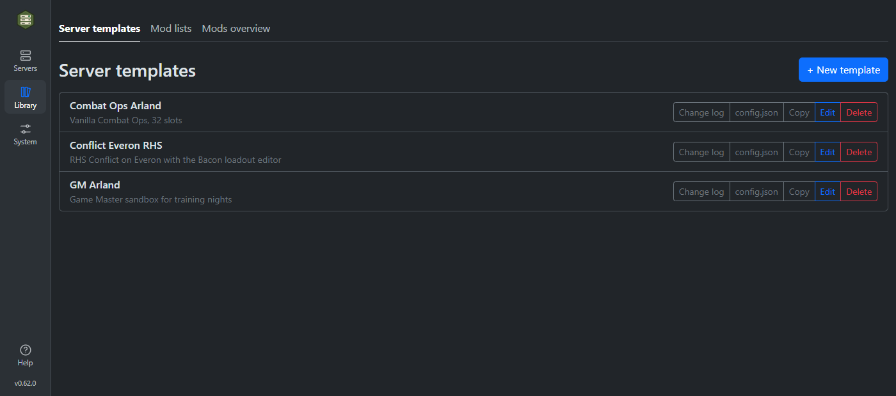
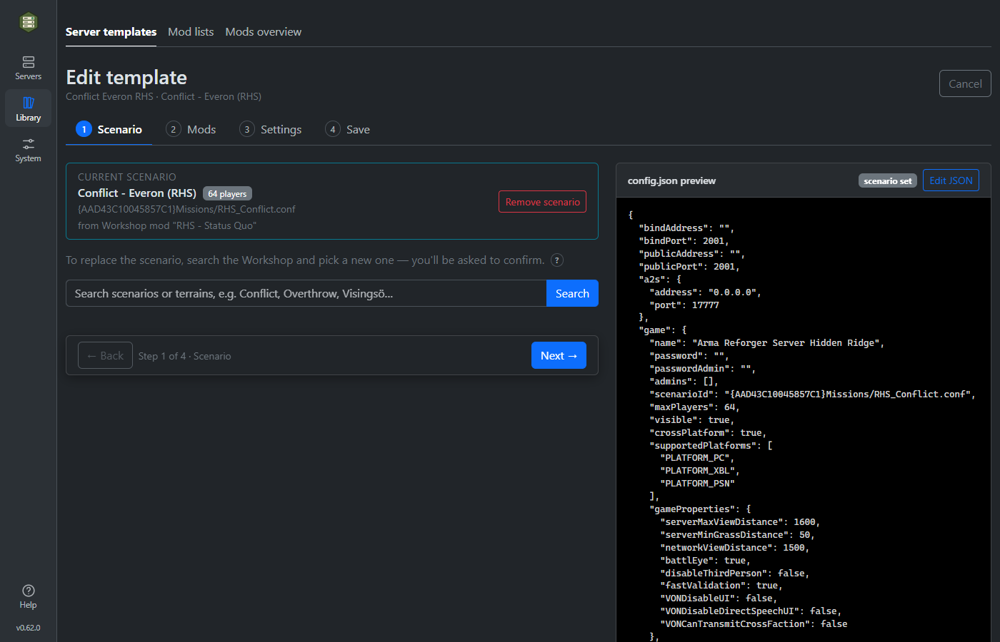
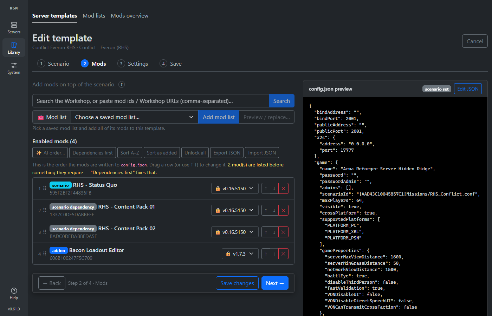
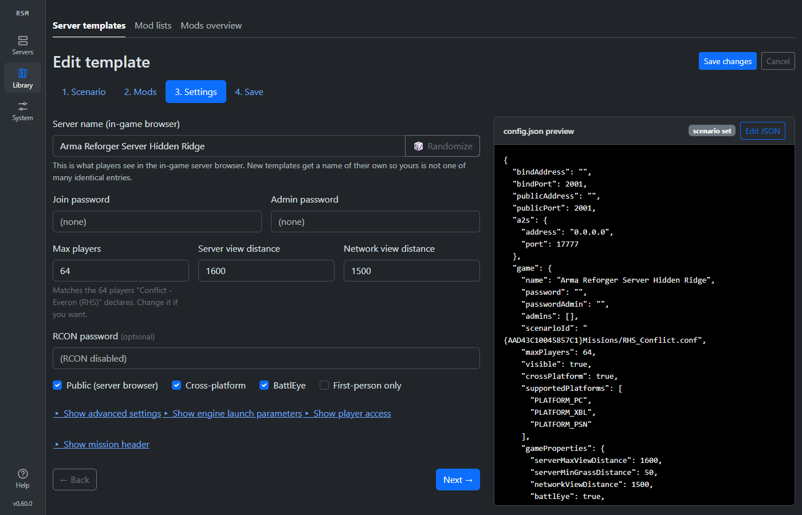
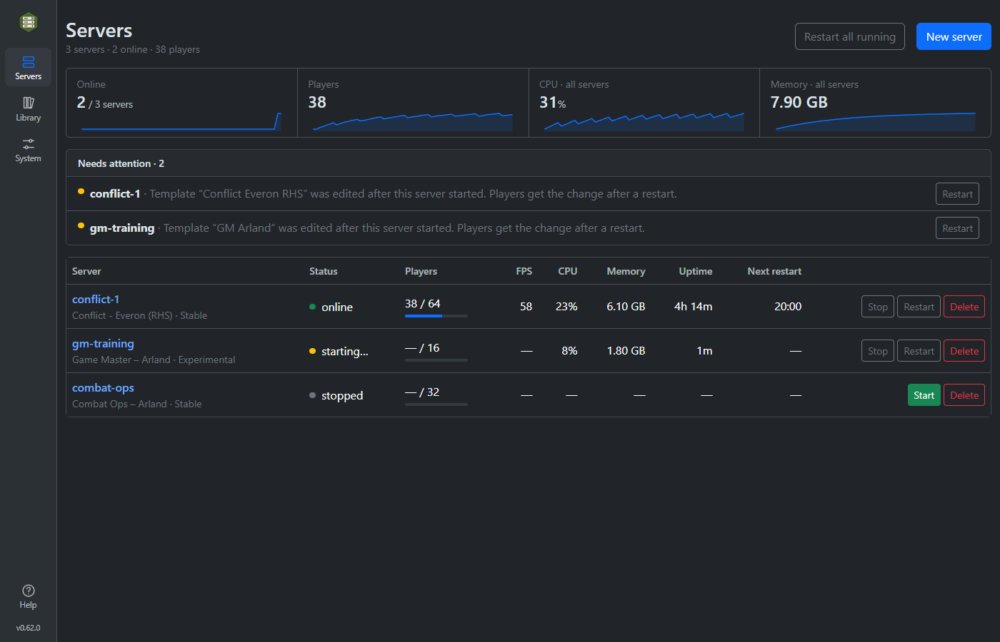
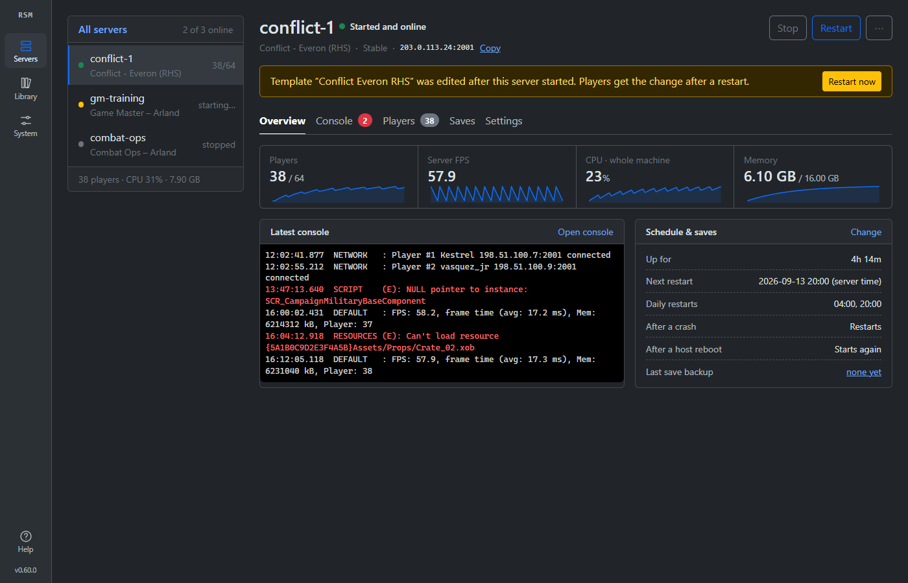

# Features

Reforger Server Manager brings the common setup and day-to-day operations for Arma Reforger Dedicated Servers into one browser interface.

[Back to README](../README.md) · [Installation guide](installation.md) · [Interactive architecture overview](https://tubalainen.github.io/reforger-server-manager/architecture/reforger-server-manager-overview.html)

## Server templates

Templates define how servers are created. They cover the scenario, Workshop mods, player limits, mission headers, admins, whitelist, bans, RCON, operating settings, and supported custom `config.json` fields.

Key template capabilities include:

- Search official and community scenarios and set per-scenario player limits.
- Start each new template with a distinguishable in-game server name instead of one
  every server shares, re-rollable in the wizard; the template is named after it until
  you type a template name of your own.
- Search the Workshop, fetch metadata, resolve dependencies, and preserve dependency order.
- Drag mods into a load order, and let **Fix order** list every mod after the mods it requires.
- With an AI service set up and answering (a local Ollama on your own GPU or any
  OpenAI-compatible service), ask it what an error in a server's Console or log files
  means (**Ask AI**). It gets the lines before the error and the template's mod
  names, with IP addresses and player ids removed, and the dialog shows exactly what was sent.
- Lock mod versions or follow current releases.
- Import an existing server `config.json` or export a generated configuration.
- Create reusable mod lists and apply them to server templates.
- Track known mods, dependency relationships, usage, update status, and local Workshop storage.
- Keep template change logs and see which servers still use an older revision.
- Move templates and mod lists through Test, Dev and Prod. Prod is locked; each release is
  a version (v1, v2, …), and a changed copy is released as the next version of the original.
  A copy of a Prod item is named after that next version ("Escapist Arland V2").
  Saves in Dev carry a comment in the change log.
- Run a server on the latest release of a Prod template, or pin it to an older version.
- Delete a template even while servers use it: the prompt names them, running ones are shut down, and they show **No template selected** until a new one is chosen in their Settings.
- File templates under game-mode categories (built-in or your own) and show one category at a time.
  A new template's category is guessed from its server name, scenario and Workshop mod.

## Server operations

Each server gets its own ports, configuration, profile, Workshop content, and lifecycle controls while sharing downloaded server binaries where appropriate.

The **Servers** page is the overview of the whole host:

- Servers online, players, and CPU and memory across all servers, with a sparkline of the last hour for each.
- One *Needs attention* list — templates edited since a server started, server files not downloaded, new server releases — each with the button that fixes it.
- A row per server with status, players against the limit, FPS, CPU, memory, uptime and next scheduled restart, plus Start, Stop, Restart and Delete.
- Restart every running server at once, after a confirmation.

A server's own page keeps every server listed down the left and splits into five tabs — Overview, Console, Players, Saves and Settings. Settings is one form with one Save: changed fields are marked, fields that need the server stopped are locked with the reason, and leaving with unsaved changes asks first. From it you can:

- Start, stop, restart, and delete a server.
- Follow live logs and copy useful diagnostic output.
- Watch a starting server download its mods: a progress bar on the Overview and Console tabs shows how much is on disk out of the total the Workshop gives for the template's mods and their dependencies, with the download speed. When the download stops growing, it says the server is loading the world.
- Control when mods change: every start keeps the mod versions already downloaded, and with **Update mods on the daily restart** the scheduled restart moves them to the newest Workshop release. Under Settings › Mods each of the template's mods shows the version on the server against the Workshop's, with **Force update** (restart now with the newest versions) and **Redownload and bake** (delete the template's mods, or every downloaded mod including older templates' leftovers, and download the template's mods again).
- View player count, process state, resource use, and server metadata.
- See who is on: each player's name, time online, platform, IP address (shown on
  request) and identity, Steam and BattlEye ids, with server admins marked.
- Recover servers after manager or host restarts.
- Configure auto-start and scheduled restarts.
- Apply template changes to existing servers.
- Start fresh after switching a server to another template: the first Start asks whether to clear the old template's downloaded mods, saved game (backed up first by default) and logs, or keep them.
- See assigned game, A2S, and RCON ports without managing leases manually.
- Back up and restore the saved game data — the world, plus the databases the scenario
  and its mods keep beside it — download a backup or upload one back, and have the
  manager take one automatically before you switch the server to another template.
- Restore a world from a template the server no longer runs: each backup is matched
  against the current scenario and hive id, and the template that reads it can be put
  back in the same action.
- Choose the template a world is restored under, and force a combination the manager
  would refuse — with the reason shown, the world it replaces always kept, and the
  forced restore recorded in the log.

## Downloads and updates

All of this lives under **System › Server files**.

- A brand-new install opens on a setup screen that pulls the SteamCMD image and the server runtime image and downloads the server files, with one **Download everything** button. It shows once; skipping it is fine.
- Download stable and experimental Arma Reforger server files with SteamCMD.
- Pull the SteamCMD image with live progress, instead of Docker fetching it silently on the first download.
- Watch download progress and recent output in real time.
- Check daily for new server builds.
- Optionally download new builds automatically and restart affected servers.
- Pull or replace the configurable server runtime image independently of manager updates.

## Configuration and data

- Edit known settings with forms or use the inline JSON editor.
- Preserve valid unknown top-level keys and custom `game` or `operating` properties during form edits.
- Validate the generated configuration before saving it.
- Back up and restore every server template and mod list as one file.
- Inspect Workshop storage and remove content that is no longer required.

Port values are assigned per server by the manager. Imported port settings therefore do not override a server's port lease.

## Access and safety

- Password-based browser authentication with session management and login rate limiting; the password can be changed in the GUI (**System › Account**), which logs out every other session.
- Several independent installs on one machine, one per team, each seeing only its own servers, ports and data (`rsm add-stack`, or the Windows installer's `-Stack`).
- On a VPS, a domain per team behind one shared HTTPS front, the edge (`rsm add-stack NAME --domain DOMAIN`, `rsm edge`), which reaches each team's manager over that team's own network only.
- The Server Supervisor: every install on the machine on one read-only page, for whoever manages the machine. It shows each stack's manager, gate, ports and servers, the totals, and what needs attention, and it never sees a team's password or a server's log text.
- `rsm cli`: every stack's game servers live in the terminal, with their state, players, FPS, CPU, memory and uptime, and start, stop and restart for whoever manages the machine.
- Fail-closed defaults when the GUI is exposed beyond localhost.
- A logout-all endpoint for invalidating every active session.
- Support for trusted reverse proxies and delegated authentication.
- A Docker gate instead of mounting the daemon socket into the manager: it has no network, passes on only the operations the manager needs, and keeps each install to its own containers, images and folders.
- `no-new-privileges` on manager-created containers.
- Edit locks that prevent two browser sessions from changing the same template simultaneously.

For deployment requirements and the security model, read the [installation guide](installation.md#security).
